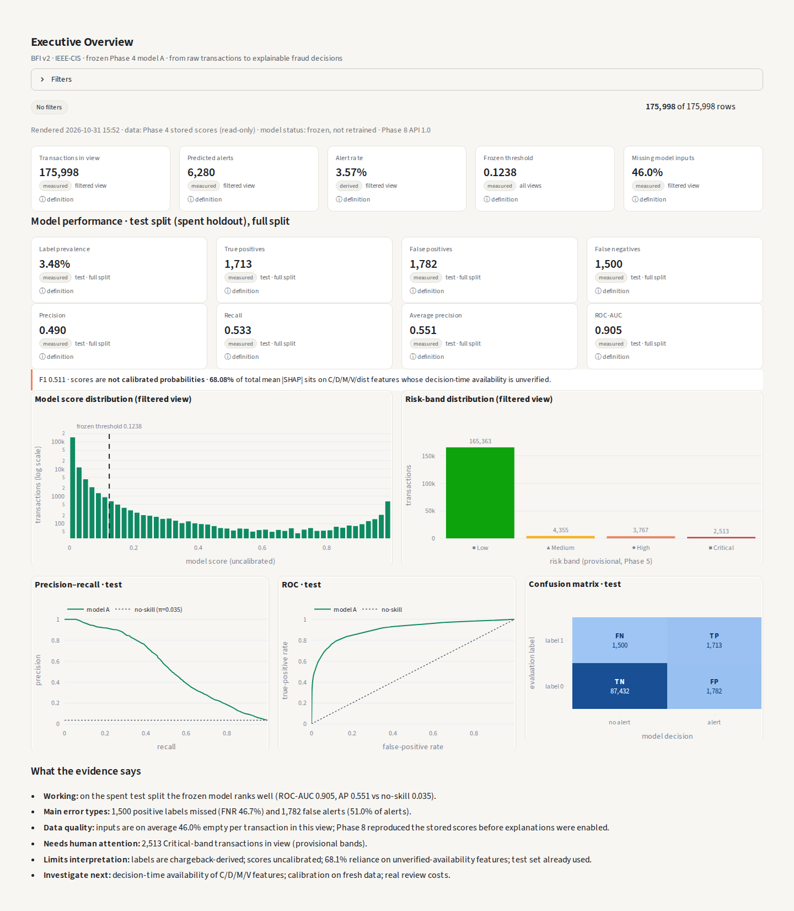
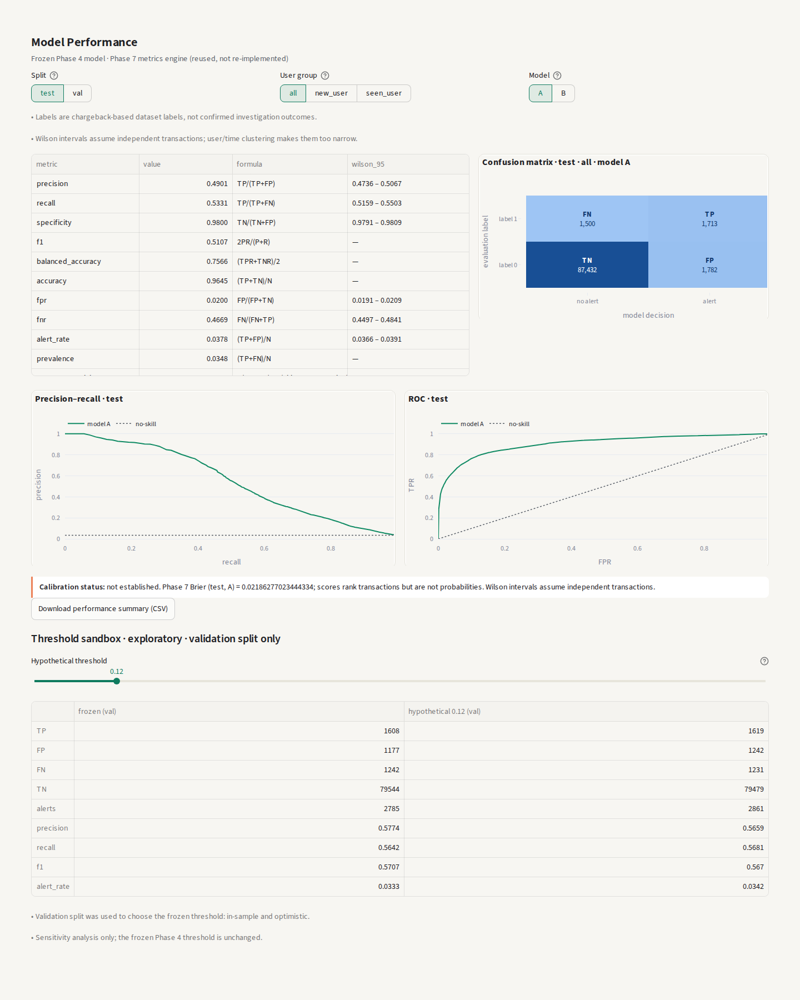
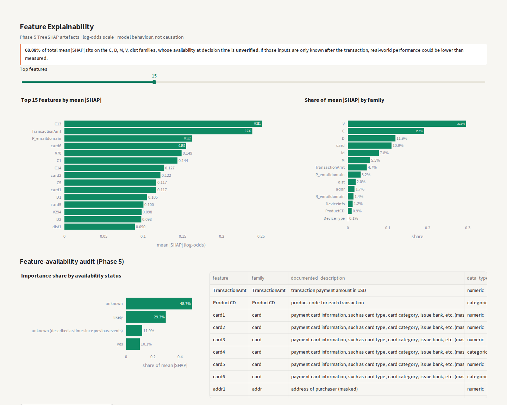
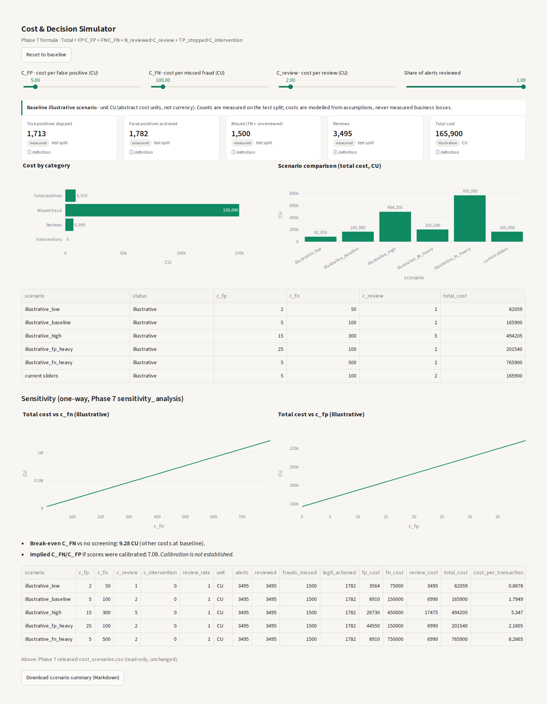
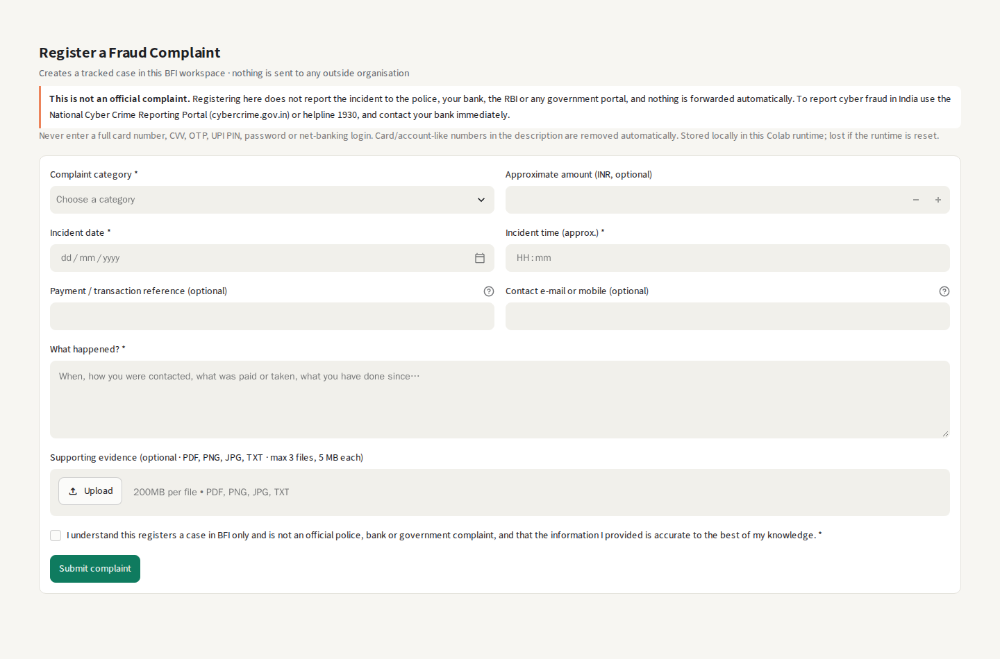
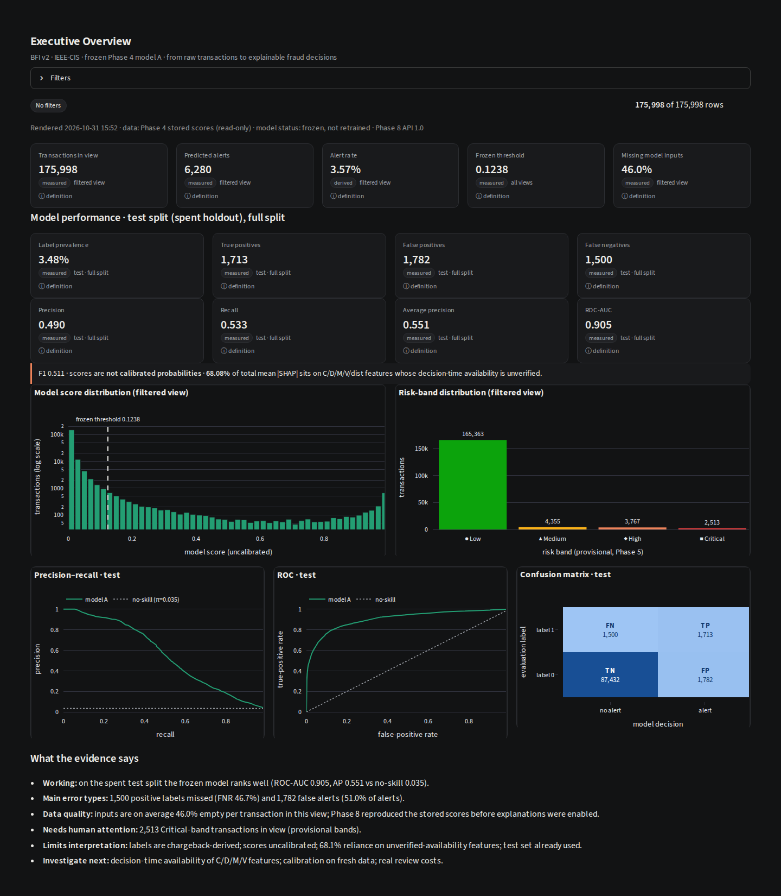
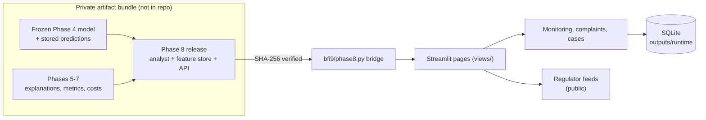
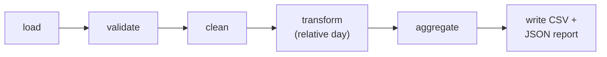

# Bharat Fraud Intelligence (BFI v2)

[](https://github.com/ezzcypher/bharat-fraud-intelligence/actions/workflows/tests.yml)


**From raw transactions to explainable fraud-review decisions.** An end-to-end fraud-analytics project: a chronological
LightGBM model on the IEEE-CIS dataset, explanations, metric and cost engines, and a 17-page Streamlit dashboard with
monitoring, complaint registration and case management, plus a reproducible data pipeline that runs on synthetic data.

> **Honest scope.** This is a research and portfolio project, **not a production fraud system**. Model scores are
> uncalibrated risk scores, an alert is a review signal (never confirmed fraud), costs are illustrative, and the licensed
> data and model artifacts are **not** in this repository. Model metrics below are **historical** results from the
> project's Colab runtime.

---

## 1. At a glance

| | |
|---|---|
| Data | IEEE-CIS Fraud Detection (590,540 transactions × 394 columns + 144,233 identity rows), used under Kaggle's rules and **not redistributed** |
| Model | LightGBM "model A", 431 features, day-based chronological split, frozen threshold 0.12379763346033115 |
| Test result (historical) | ROC-AUC **0.905**, PR-AUC **0.551**, precision **0.490**, recall **0.533** at 3.5 % prevalence |
| App | Streamlit + Plotly, 17 pages, light/dark theme, investigation vs evaluation mode |
| Engineering | Hash-verified bridge to frozen artifacts, parameterised SQLite, PII scrubbing, CI on synthetic fixtures |

## 2. Screenshots

Captured from the private Colab runtime (with the licensed artifacts present), cropped to the page content. They show
aggregate results only: no transaction-level rows from the licensed data.

| Executive overview | Model performance |
|---|---|
|  |  |
| **Feature explainability** | **Cost & decision simulator** |
|  |  |
| **Register complaint (local only)** | **Dark theme** |
|  |  |

## 3. Problem and approach

Card-not-present fraud is rare (3.5 % of test transactions here), so accuracy is meaningless and every alert costs
analyst time. The project asks: *which transactions should a reviewer look at first, and how sure can we be about what
the model is doing?*

1. **Start honestly.** BFI v1 used an Indian-banking dataset whose labels turned out to be near-random (validation
   ROC-AUC 0.528). Rather than tune noise, the project was rebuilt on IEEE-CIS, which has documented chargeback labels.
2. **Freeze before you report.** Model, split, threshold and stored predictions were frozen in Phase 4; later phases
   only read them.
3. **Explain and audit.** TreeSHAP explanations, a feature-availability audit and an illustrative cost model.
4. **Make it usable.** A dashboard that shows evidence class and source for every number, and refuses to show numbers it
   cannot verify.

## 4. Key results (historical, test split, frozen model A)

| TP | FP | TN | FN | Precision | Recall | F1 | PR-AUC | ROC-AUC |
|---:|---:|---:|---:|---:|---:|---:|---:|---:|
| 1,713 | 1,782 | 87,432 | 1,500 | 0.4901 | 0.5331 | 0.5107 | 0.5506 | 0.9052 |

About half of the alerts carry the fraud label, and the model flags about 53 % of labelled-fraud transactions while
alerting on 2 % of the rest. These values were released by the Phase 7 metrics engine and **recomputed identically
(17/17 values, difference 0)** through the Phase 9 bridge. Details, provenance and caveats:
[docs/MODEL_EVALUATION.md](docs/MODEL_EVALUATION.md).

## 5. Features

- **Executive overview, risk analytics, model performance:** KPIs with definitions and sources, PR/ROC curves, confusion
  matrix, risk bands.
- **Transaction explorer and investigation:** filters only on fields that exist; per-transaction TreeSHAP explanations.
- **Cost & decision simulator:** illustrative cost scenarios, break-even and one-way sensitivity; threshold sandbox on
  validation only.
- **Forecasting & scenarios:** relative-day volume baselines with backtested intervals (no fraud forecasts, no dates).
- **Live Monitoring:** an ingestion interface plus a clearly labelled **DEMO DATA** replay of historical test rows.
- **Register complaint / Case management:** local complaint registration, status workflow with audit trail, evidence
  upload checks, redacted export.
- **AI Fraud Analyst:** deterministic, evidence-citing answers (LLM disabled by design).
- **Global Fraud Intelligence:** public regulator feeds (SEC, RBI, SEBI; FTC listed) with redaction of private names.
- **Formula & Solution Explorer:** 42 formulas, each with problem, notation, code, output, limitations and source.
- **Data Sources, Status & Audit:** lineage, dependency provenance and hash checks.

## 6. Architecture



The app reaches the frozen artifacts only through `bfi9/phase8.py`, which verifies the Phase 8 release archive and every
source file by SHA-256 before importing. If anything is missing, pages say so instead of inventing numbers. More:
[docs/ARCHITECTURE.md](docs/ARCHITECTURE.md).

## 7. Data pipeline



`src/pipeline/run.py` validates IEEE-CIS-format files (schema, IDs, duplicates, times, amounts, labels), removes and
counts failing rows, adds the relative day, and writes daily and product-mix summaries with a JSON report. It runs on the
fictional `examples/synthetic_transactions.csv` or on your own Kaggle download, and it **never scores rows**.
More: [docs/DATA_PIPELINE.md](docs/DATA_PIPELINE.md).

## 8. Model and evaluation

- LightGBM, 431 features (32 categorical), day-based chronological split (train → validation → test).
- Threshold chosen on validation only (best recall at precision ≥ 0.50 over the last 14 validation days).
- Metrics from the Phase 7 engine: threshold metrics, ranking metrics, Wilson intervals, calibration table, Brier score.
- The test set is spent: further threshold exploration in the app runs on validation and is labelled exploratory.

## 9. Explainability

TreeSHAP (LightGBM `pred_contrib`) on the log-odds scale with an additivity check per explanation, plus global importance.
**68.08 % of total mean |SHAP| sits on C/D/M/V/dist features whose decision-time availability is unverified**, so
real-world performance could be lower. SHAP describes model behaviour, not causation.

## 10. Live monitoring (DEMO DATA)

No real bank, UPI, card-network or government feed is connected. The ingestion interface validates the full model schema
row by row, de-duplicates, scores with the frozen model and stores events. The **DEMO DATA** button replays historical
IEEE-CIS test rows with a simulated arrival time; every such event carries a visible DEMO DATA badge.

## 11. Complaints and case management

Complaints stay **local**: they are not police, bank, RBI or government complaints, and nothing is forwarded. Full card
numbers are refused, only the last 4 characters of a reference are kept, OTP/CVV/PIN-like values are scrubbed, contacts
are masked and never exported, and evidence files are type- and size-checked. Case statuses follow an enforced workflow
with an audit trail. Details: [docs/OPERATIONS.md](docs/OPERATIONS.md).

## 12. Tech stack

Python 3.13 · pandas · NumPy · SciPy · scikit-learn · LightGBM · Streamlit · Plotly · SQLite · pytest · GitHub Actions ·
Google Colab (development host).

## 13. Repository structure

```
app.py                     Streamlit entry point (17 pages)
bfi9/                      core package: settings, Phase 8 bridge, data, quality, charts, UI,
                           monitoring, cases, store, formulas, forecasting, intelligence/
views/                     one module per page
src/pipeline/              public data pipeline + synthetic data generator
examples/                  synthetic_transactions.csv (fictional, labelled SYNTHETIC)
tests/                     unit, page-render and pipeline tests
notebooks/                 Formula & Solution Explorer notebook
outputs/                   formula catalogue and project history table read by the app
docs/                      architecture, data, pipeline, evaluation, operations, security, limitations
package_meta/              publication audit, excluded files, CI-deselected tests, manifest
.github/workflows/         CI
```

## 14. Quick start (local)

```bash
git clone https://github.com/ezzcypher/bharat-fraud-intelligence.git
cd bharat-fraud-intelligence
python -m venv .venv && source .venv/bin/activate   # Windows: .venv\Scripts\activate
pip install -r requirements.txt

python -m src.pipeline.run --input examples/synthetic_transactions.csv --out outputs/pipeline_demo
streamlit run app.py
```

Without the private artifact bundle, model pages show a clear "unavailable" state; complaints, cases and the pipeline
work. To enable reviewer actions, set `BFI9_REVIEWER_CODE` before launching (see `.env.example`).

## 15. Run in Google Colab (private, no public link)

```python
from google.colab.output import eval_js; from google.colab import output; import subprocess, time
APP = "/content/bharat-fraud-intelligence"
ORIGIN = eval_js("google.colab.kernel.proxyPort(8501)").rstrip("/")   # this session's private proxy origin
subprocess.Popen(f"cd {APP} && exec streamlit run app.py --server.port 8501 --server.corsAllowedOrigins {ORIGIN} "
                 "> /content/streamlit.log 2>&1", shell=True, start_new_session=True)
time.sleep(15)
output.serve_kernel_port_as_iframe(8501, height=900)
```

- Use the iframe. `serve_kernel_port_as_window` may only print a `https://localhost:8501/` link, which points at your
  own computer, not the Colab VM.
- CORS stays on; only this session's proxy origin may open the app's WebSocket. No public tunnel is used.

## 16. Configuration

All settings are environment variables (see `.env.example`, placeholders only): `BFI_ROOT` (private artifact bundle),
`BFI9_MODE` (`investigation` / `evaluation`), `BFI9_OPS_DB`, `BFI9_REVIEWER_CODE`, `BFI9_SEC_USER_AGENT`.

## 17. Testing and CI

```bash
python -m pytest -q                        # full suite: needs the private artifact bundle (BFI_ROOT)
BFI_PUBLIC_CI=1 python -m pytest -q        # what CI runs: no licensed data, no secrets, no retraining
```

GitHub Actions installs the pinned requirements, runs the pipeline on the synthetic example and runs the test suite with
`BFI_PUBLIC_CI=1`. Tests that need the licensed data or frozen model are **deselected** (reported by pytest as
"deselected", not hidden), and each is listed with its reason in `package_meta/CI_DESELECTED_TESTS.csv`. Full-suite
results from the private runtime are in [docs/MODEL_EVALUATION.md](docs/MODEL_EVALUATION.md#test-evidence-from-the-private-colab-runtime-2026-10-31).

## 18. Security and privacy

No secrets are required or stored. Inputs are validated, SQL is parameterised, uploads are checked, personal data is
scrubbed or masked, diagnostics are redacted, and no external LLM is called. The repository was assembled by a recorded,
locally scanned publication audit. See [docs/SECURITY.md](docs/SECURITY.md).

## 19. Limitations

Not production-ready · no real-time source (DEMO DATA only) · uncalibrated scores · chargeback-derived labels ·
illustrative costs · no calendar dates · 68 % of explanation weight on features of unverified availability · Phase 6 v1.1
and Phase 7 **reconstructed** from hash-verified files · single shared reviewer code · licensed data and model not
included. Full list: [docs/LIMITATIONS.md](docs/LIMITATIONS.md).

## 20. What this project demonstrates

- **Data analysis:** data-quality audits, imbalance-aware metrics, cost framing, clear communication of uncertainty.
- **Data science:** chronological validation, threshold selection on validation only, SHAP explanations, leakage and
  feature-availability auditing, reproducible evaluation.
- **Data engineering:** validated ingestion, de-duplication, schema contracts, hash-verified artifact loading, SQLite
  persistence, a tested pipeline and CI.

## 21. Data and licence

- **Code and documentation:** MIT licence, see [LICENSE](LICENSE).
- **IEEE-CIS data** belongs to its providers and is subject to the Kaggle competition rules; it is not included. Download
  it with your own Kaggle account.
- **Model artifacts** derived from that data are not included.
- `examples/synthetic_transactions.csv` is fictional and generated by this repository.

## 22. Author

Yashvardhan. Built as a portfolio project for data analyst, data scientist and data engineering roles.
