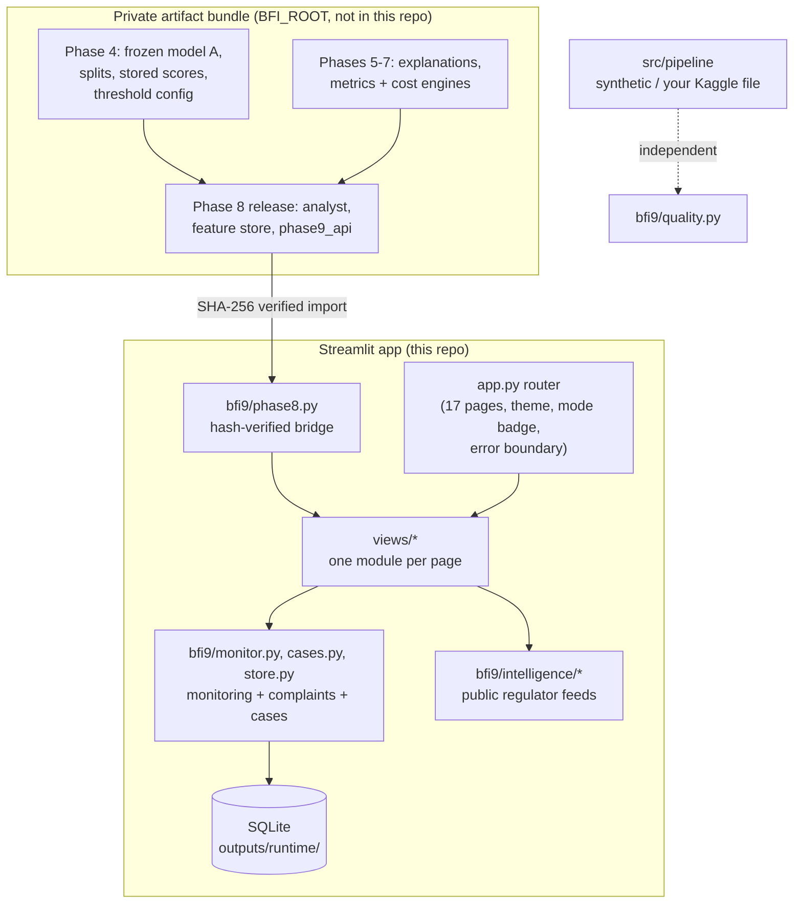

# Architecture

## 1. System overview



- **Single bridge.** `bfi9/phase8.py` is the only way into Phases 4–8. It checks the Phase 8 release archive's SHA-256,
  checks every Phase 8 source file against that archive, confirms each module was imported from the verified folder,
  redirects Phase 8's runtime writes into `outputs/runtime/`, and confirms the Phase 8 threshold equals the Phase 4
  config. Any failure raises `Phase8Unavailable`, and pages show the reason instead of numbers.
- **Frozen facts are read, never typed.** `bfi9/settings.py` reads the threshold and model facts from the Phase 4 config.
- **Mode is fixed at launch.** `BFI9_MODE=investigation` (default, labels hidden) or `evaluation`. No widget or question
  text can change it, and a badge shows it on every page.
- **Two projects, never merged.** BFI v1 (Indian banking, near-random labels) and BFI v2 (IEEE-CIS) are kept apart; no
  chart or KPI mixes their rows.

## 2. Package layout

```
app.py                  st.navigation router, theme, mode badge, error boundary
bfi9/
  settings.py           paths (BFI_ROOT), frozen facts read from Phase 4/5 files
  phase8.py             the ONLY bridge to Phases 4-8 (hash verification)
  data_v2.py            evaluation-row frame: stored scores + feature-store columns
  data_v1.py            BFI v1 raw/cleaned data (read-only)
  quality.py            data-quality KPIs, missingness, IQR outliers, schema comparison
  filters.py            filter state -> boolean mask (pure pandas)
  charts.py, ui.py      Plotly figures and design tokens (light/dark)
  forecasting.py        relative-day volume baselines, rolling-origin backtest, PSI
  formulas.py           Formula & Solution Explorer catalogue bound to real implementations
  reports.py, exporters.py   report parsing/comparison; CSV/Markdown/HTML export with redaction
  monitor.py            ingestion: validate -> de-duplicate -> score (frozen model) -> store
  cases.py, store.py    complaints, case workflow, evidence, audit trail (SQLite)
  provenance.py         reconstructed-dependency status from marker files
  intelligence/         regulator feeds, incident rules, market event studies (no model imports)
views/                  one module per page, each exposing render()
src/pipeline/           public data pipeline + synthetic data generator
tests/                  unit, page-render and pipeline tests
notebooks/              Formula & Solution Explorer notebook (outputs from the private runtime)
```

## 3. Read-only contracts with Phase 8

| Need | Call | Notes |
|---|---|---|
| Scores, splits, decision, band | `data_access.predictions()` | `isFraud` is dropped unless the mode is `evaluation`. |
| Metrics, curves | `metrics_adapter` → Phase 7 `metrics_engine` | Threshold sandbox runs on **validation only**; test values are frozen. |
| Costs | `phase9_api.cost_scenario(base, **overrides)` | Overrides are tagged `user_supplied`; stored scenarios are never written. |
| Transaction, explanation | `phase9_api.transaction / explanation(id, mode)` | Status ∈ available / unavailable / inconsistent / not_found. |
| Assistant | `phase9_api.ask(question, mode)` | Deterministic; the mode comes from the launch setting. |
| Global importance, availability | `explanation_adapter` | The 68.08 % reliance figure is recomputed at startup with its source. |

## 4. Navigation (17 pages)

| Group | Pages |
|---|---|
| Overview | Executive Overview · Live Monitoring · Fraud & Risk Analytics |
| Investigate | Transaction Explorer · Transaction Investigation · Feature Explainability |
| Cases | Register Complaint · Case Management |
| Model | Model Performance · Cost & Decision Simulator · Forecasting & Scenarios |
| Data & Reports | EDA & Data Quality · Report Comparison |
| Intelligence | AI Fraud Analyst · Global Fraud Intelligence · Formula & Solution Explorer |
| System | Data Sources, Status & Audit |

A page whose dependency check fails shows its reason instead of content. One error boundary around every page shows a
friendly message with a reference code; details go to the redacted local diagnostics log.

## 5. Visual system

- Design tokens for surface, background, border, text, muted, accent and risk colours; risk is always **colour + label +
  icon**, never colour alone.
- An in-app theme toggle drives CSS variables, a Plotly template for every figure and Streamlit's native theme.
- Every KPI card shows value, definition, source, scope (split) and evidence class (measured / derived / assumed /
  illustrative / unknown).
- Categorical chart colours were checked for contrast in light and dark mode.

## 6. Forecasting scope

IEEE-CIS has 182 relative days and no calendar. Allowed: daily transaction volume by relative day, seasonal-naive and
rolling-mean baselines, rolling-origin backtests (MAE, MAPE), horizon ≤ 14 relative days. Alert/review workload is shown
as labelled scenarios. Never: forecasts of fraud labels, or of dates.

## 7. Operations modules

See [OPERATIONS.md](OPERATIONS.md) for the ingestion contract, the DEMO DATA replay, the complaint data handled, the case
status workflow and how to swap SQLite for a production database.
