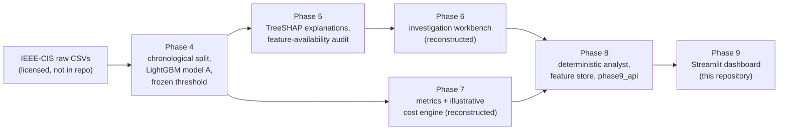
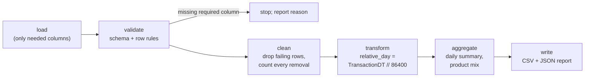

# Data pipeline and lineage

## 1. Data sources and rights

| Source | Used for | In this repository? |
|---|---|---|
| IEEE-CIS Fraud Detection (Kaggle competition data) | BFI v2 model training and evaluation (Phases 4–9) | **No.** Competition rules restrict redistribution. Download it yourself with your own Kaggle account and accept the rules. |
| Phase 8 feature store (175,998 × 433, validation + test rows) | Dashboard filters, explanations, DEMO DATA replay | **No.** Row-level data derived from IEEE-CIS. |
| Frozen Phase 4 model, stored predictions, Phase 5–8 release archives | Scoring, metrics, explanations | **No.** Derived from licensed data; redistribution not cleared. |
| BFI v1 Indian banking CSV (`indian_banking_transactions.csv`) and a synthetic 770k-row monitoring CSV | Earlier project (v1) shown on EDA / Report pages | **No.** Their licence is not documented. |
| `examples/synthetic_transactions.csv` | Pipeline demo, CI | **Yes.** 2,000 fictional rows created by `src/pipeline/make_synthetic.py`. |

Nothing in this repository is sampled from, or derived row-by-row from, licensed data.

## 2. End-to-end lineage (how the project was built)



| Phase | Output | Status |
|---|---|---|
| 1–3 (BFI v1) | Audit, baseline and cleaned Indian-banking dataset | Superseded: the v1 labels proved close to random (validation ROC-AUC 0.528), so the project was rebuilt on IEEE-CIS |
| 4 | Frozen model A, splits, stored scores, threshold 0.12379763346033115 | Verified, read-only |
| 5 | Explanations and availability audit (v1.0) | Verified; v1.2 archive missing |
| 6 v1.1 | Investigation workbench | **Reconstructed** from hash-verified files |
| 7 | Metrics and cost engine | **Reconstructed** from hash-verified files |
| 8 | AI Fraud Analyst (deterministic, LLM disabled), feature store, Phase 9 API | Closed release, hash-verified at runtime |
| 9 | This dashboard + operations modules | This repository |

The Phase 9 app reaches Phases 4–8 **only** through `bfi9/phase8.py`, which checks the Phase 8 release archive's SHA-256
and every Phase 8 source file before importing it. If anything is missing or different, the affected pages show an
"unavailable" state instead of invented numbers.

## 3. The public pipeline (`src/pipeline/`)



```bash
python -m src.pipeline.run --input examples/synthetic_transactions.csv --out outputs/pipeline_demo
```

| Stage | Rules |
|---|---|
| Load | Reads `TransactionID, TransactionDT, TransactionAmt, ProductCD` (required) and `card4, card6, P_emaildomain, isFraud, data_origin` (optional). Works on the full 394-column IEEE-CIS file. |
| Validate | Missing required column → stop. Row rules: positive integer `TransactionID`; no duplicate IDs (first kept); non-negative integer `TransactionDT`; positive `TransactionAmt`; `isFraud` in {0, 1}. `ProductCD` outside W/C/R/H/S is a warning. |
| Clean | Removes failing rows and reports the count per rule. Never fills or imputes values. |
| Transform | Adds `relative_day`. It is never converted to a calendar date (the dataset has none). |
| Aggregate | `daily_summary.csv` (transactions, total and median amount, label rate if labels exist) and `product_mix.csv`. Data-quality KPIs come from the app's own `bfi9/quality.py`. |
| Write | `clean_transactions.csv`, the two summaries and `pipeline_report.json` (counts, issues, data origin, notes). Outputs go to a git-ignored folder. |

**The pipeline never scores transactions.** Scoring needs the frozen model, which is not distributed, and fictional rows
must not be presented as model predictions.

## 4. Synthetic example data

`examples/synthetic_transactions.csv` (2,000 rows, 9 columns) is generated by `python -m src.pipeline.make_synthetic`
(fixed seed, NumPy `RandomState`, reproducible byte-for-byte; a test checks this).

| Column | Fictional content |
|---|---|
| `TransactionID` | 900000001 … 900002000 (outside the IEEE-CIS ID range) |
| `TransactionDT` | random seconds over 30 relative days |
| `TransactionAmt` | log-normal amounts |
| `ProductCD`, `card4`, `card6` | random categories in the IEEE-CIS vocabulary |
| `P_emaildomain` | reserved example domains (`example.com/.org/.net`) or empty |
| `isFraud` | independent 3.5 % random draw: **no fraud signal** |
| `data_origin` | always `SYNTHETIC` |

## 5. Reproducing the dashboard with the real data

Full reproduction needs the private artifact bundle (frozen model, Phase 4–8 release archives and the feature store)
plus your own licensed IEEE-CIS download. The bundle is not public, because it contains model artifacts and data derived
from licensed rows. With the bundle in a folder:

```bash
export BFI_ROOT=/path/to/private/artifact_bundle
streamlit run app.py
```

You can always run the public pipeline on your own Kaggle download:

```bash
python -m src.pipeline.run --input /path/to/train_transaction.csv --out outputs/pipeline_ieee
```
